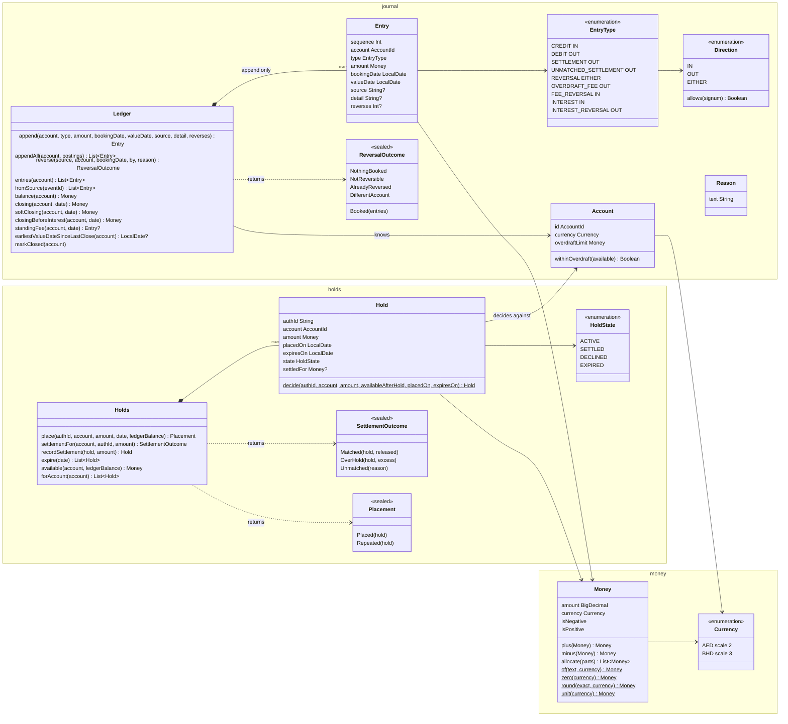

# Design

An in-memory account ledger core for two accounts over six processing days. No web layer, no persistence, no UI. A JUnit suite replays the event stream and prints, per day: closing ledger balance, fees, authorization states and errors.

## The question the design is built around

"What was that day's closing balance?" can have a different answer later than it had at the time, because an entry can arrive days after the day it belongs to. Everything below follows from taking that seriously:

- balances are derived, never stored
- rules re-run when the past changes
- corrections are new entries, never edits
- only authorizations are conditional: the ledger may say no to a hold. Everything that reports money already moved (credits, debits, settlements, reversals) is unconditional and always books; the fee rule handles the consequences
- two kinds of no: a legitimate refusal is a typed outcome (`SettlementOutcome`, `ReversalOutcome`, `Assessment`, a DECLINED hold) and never an exception; an impossible input (for example a wrong scale, mixed currencies, a blank reason, a second capitalization) throws a named `DomainError` from the type whose rule it breaks, and nothing catches it. Each area keeps its errors in an `error` sub-package; the base class lives in `domain/error`

## Five concerns and one orchestrator

| Concern | Owns | Reads | Writes |
|---|---|---|---|
| Money | the shared value types: amounts at currency precision, rounding, splitting. No rule of its own; every other area is built on it and it depends on none of them | — | — |
| Journal | append-only entries, closing balance by value date | — | entries |
| Holds | authorizations, available balance, settlement | — | — |
| Fees | overdraft fee per overdrawn value day, and its reversal | journal closings | fee entries |
| Interest | daily accruals, one capitalization | journal closings | one interest entry |
| Replay | the processing clock, event dispatch, the per-day report | all of the above | event entries, through the journal |

The first five are the domain: money is the shared kernel, and each of the other four owns one rule from the brief, a few types and one test class. The application layer is one use case per job, grouped by the domain area it exercises (`journal`: PostCreditUseCase, PostDebitUseCase, ReverseUseCase; `holds`: AuthorizeUseCase, SettleUseCase; `close`: CloseDayUseCase), each a small class that calls the domain and returns what happened as notes; `Replay` only owns the clock and picks the use case for each operation. The layer decides nothing about money; every yes or no comes back from a domain type as an outcome. There is no infrastructure, so there are no ports or adapters.

```
application/
  operation/ Operation and its five kinds
  journal/   PostCreditUseCase, PostDebitUseCase, ReverseUseCase
  holds/     AuthorizeUseCase, SettleUseCase
  close/     CloseDayUseCase
  report/    DayReporter, DayReport, AccountReport, Restatement, Note, Severity, ReportPrinter
  Replay     clock and dispatch
  Window     the anchor date and the Day N label
  Scenario   the two accounts and the ten events
```

## Class diagrams

Domain: money, journal, holds.



Rules and orchestration: fees, interest, replay.

```mermaid
classDiagram
direction TB
namespace fees {
  class FeeSchedule {
    overdraftFee(currency) Money?
  }
  class FeeSweep {
    run(account, from, today) SweepResult
  }
}
namespace interest {
  class Interest {
    recompute(account, from, today)
    provisional(account) Map~LocalDate, Money~
    capitalize(account, bookingDate) Capitalization
  }
  class Capitalization {
    exact BigDecimal
    paid Money
    dailies Map~LocalDate, Money~
    entry Entry?
  }
}
namespace application {
  class Operation {
    <<sealed>>
    id String
    day Int
    account AccountId
  }
  class Credit
  class Debit
  class Authorization
  class Settlement
  class Reversal {
    reverses String
    reason String
  }
  class Note {
    severity Severity
    message String
  }
  class Replay {
    process(operation)
    closeDay() DayReport
    run(operations) List~DayReport~
  }
  class PostCreditUseCase {
    execute(operation, today) List~Note~
  }
  class PostDebitUseCase {
    execute(operation, today) List~Note~
  }
  class AuthorizeUseCase {
    execute(operation, today) List~Note~
  }
  class SettleUseCase {
    execute(operation, today) List~Note~
  }
  class SettlementBooking {
    type EntryType
    detail String
    notes List~Note~
  }
  class ReverseUseCase {
    execute(operation, today) List~Note~
  }
  class CloseDayUseCase {
    execute(day, date, notes) DayReport
  }
  class DayReporter {
    report(account, date, swept, capitalization, notes) AccountReport
  }
  class DayReport {
    date LocalDate
    accounts List~AccountReport~
  }
}
class Ledger
class Holds
Operation <|-- Credit
Operation <|-- Debit
Operation <|-- Authorization
Operation <|-- Settlement
Operation <|-- Reversal
FeeSweep --> Ledger : reads closings, appends fees
FeeSweep --> FeeSchedule
Interest --> Ledger : reads closings, appends once
Interest ..> Capitalization : returns
Replay --> Operation : consumes
Replay --> PostCreditUseCase
Replay --> PostDebitUseCase
Replay --> AuthorizeUseCase
Replay --> SettleUseCase
Replay --> ReverseUseCase
Replay --> CloseDayUseCase : at each day change
PostCreditUseCase --> Ledger
PostDebitUseCase --> Ledger
AuthorizeUseCase --> Holds
SettleUseCase --> Holds
SettleUseCase --> Ledger
SettleUseCase ..> SettlementBooking : decides, then books
ReverseUseCase --> Ledger
CloseDayUseCase --> FeeSweep
CloseDayUseCase --> Interest
CloseDayUseCase --> Holds : expires
CloseDayUseCase --> DayReporter
CloseDayUseCase ..> DayReport : produces
```



## Money

- `Money(amount: BigDecimal, currency)`: a value with its currency.
- The constructor refuses an amount whose scale differs from the currency's. A 2-decimal BHD figure cannot exist.
- Scales are hardcoded in `Currency` (AED 2, BHD 3) and verified against ISO 4217 by a test.
- `BigDecimal`, never floating point. Integer minor units would be the fallback without it.
- Rounding is HALF_EVEN, applied in one method. It changes no number in this stream.
- Splitting uses largest remainder: the parts differ by at most one minor unit and always sum to the original.
- Equality is by value; safe because the scale invariant means the same value can only ever have one representation.
- On the wire an amount is a decimal string plus a currency code. `Money.of` is that boundary.

## Journal

- An append-only list of entries, one sequence number each, in arrival order. An operation that books several entries (instalments, a reversal of several entries) appends them all or nothing: every posting is validated before any is written.
- An account: id, currency, overdraft limit (0 for both accounts here).
- An entry: account, type, signed amount, booking date, value date (both calendar dates), a source (the event id it came from; rule entries have none), an optional detail (what it is, in words) and, for reversals of any kind, the sequence number of the entry it undoes. Reversals look entries up by source, never by the printed text.
- Types: CREDIT, DEBIT, SETTLEMENT, UNMATCHED_SETTLEMENT, REVERSAL, OVERDRAFT_FEE, FEE_REVERSAL, INTEREST, INTEREST_REVERSAL.
- Signed amounts rather than two columns. The sign is guarded against the type at append.
- A reversal is just another line with the opposite sign. It references the entry it undoes and must carry a `Reason` (duplicate, wrong amount, returned payment, won dispute, operations correction). `Reason` is a journal value type that refuses blank text, so neither the journal nor an operation can hold a reversal without one. The brief gives none for its reversal, so the scenario passes "not stated by the brief" explicitly and AMBIGUITIES records it.
- A reversal takes the original's value date, so the history reads as if the original never happened. A refund is different: new money, a CREDIT with its own value date.
- Only entries that came from events can be reversed by an event. Fees and interest are corrected by their own rules. A reversal of a reversal, a second reversal of the same event, or a reversal quoting another account's event is refused.
- The journal owns the reversal rule (`Ledger.reverse`) and returns an outcome; the replay only records the refusal.
- An entry means money moved. Declines and rejections never become entries.
- `closing(account, day)`: sum of that account's entries with value date ≤ day. Recomputed on every call.
- Cost accepted: a scan per query. Bought: correctness under back-dating for free. A per-day index is the first thing to add at scale.

## Holds

- A hold is a promise, not a movement. It lives in the holds book beside the journal and never enters a balance.
- `available = ledger balance − active holds`, where ledger balance is the closing balance as of today.
- Authorizations are conditional: approve if the available balance after the hold is within the account's overdraft limit (`available − amount ≥ −limit`; the account owns that rule). The account's overdraft limit is a production knob; both accounts here have 0, so the rule reduces to "available stays at or above zero". Exactly zero approves.
- Debits and settlements are unconditional: they always book, whatever the balance.
- States: ACTIVE, SETTLED (keeps the settled amount), DECLINED (kept so the report can show it), EXPIRED.
- The authorization id is the network's reference, given in the request. Production adds the second identifier a card issuer owns: an approval code generated when a hold is approved, carried on the hold and required on the settlement as proof of approval. The brief's settlements quote only the reference, so the code is not modelled.
- The holds book is keyed by account and authorization id. Placing a hold is idempotent on that key: networks retry an authorization when a response times out, so the same id can arrive twice; the second arrival returns the original decision, places nothing, and the report notes the repeat. The same id on another account is that account's own, separate hold, and a settlement quoting another account's id finds nothing.
- Hold and settlement amounts are positive magnitudes; a non-positive one is refused before anything changes.
- A settlement is decided, then its journal entry is appended, then the hold is recorded as settled: journal first, projection second, so a failed append leaves the holds book untouched.
- An authorization is decided on the balance as known at that moment and the decision is final. A later back-dated entry or reversal never re-opens it.
- The holds book is a projection: it is rebuilt by replaying authorization and settlement events, so a hold's state may change in place. Append-only governs events and the journal, not this projection.
- A hold expires at the close of the seventh day after it was placed, is released, and no longer counts against available. Scheme rules vary by merchant category (7 days for most, 30 for hotels and car rental); mapping expiry to merchant category codes is out of scope, 7 is used for all.
- A settlement is a command, not a request. It always books a debit. The auth id it quotes decides only how the entry is labelled:
  - ACTIVE hold, amount at or below it: SETTLEMENT. Hold → SETTLED, residual released.
  - ACTIVE hold, amount above it: SETTLEMENT, flagged with the excess. Hold → SETTLED.
  - No such auth id: UNMATCHED_SETTLEMENT, reason "never authorized".
  - Hold DECLINED: UNMATCHED_SETTLEMENT, reason "declined". Hold unchanged.
  - Hold already SETTLED: UNMATCHED_SETTLEMENT, reason "already settled". Hold unchanged.
  - Hold EXPIRED: UNMATCHED_SETTLEMENT, reason "expired". Hold unchanged.
- Why book the unmatched ones: the merchant has cleared and the issuer's obligation exists. The reason recorded on the entry is what a later dispute (chargeback, "I did not make this transaction") is raised from. Disputes themselves are out of scope; a won dispute would arrive as a REVERSAL of the settlement entry.
- Not modelled: void, incremental authorization, multiple clearings against one hold, account freeze.

## Fees

- The fee is checked when a day closes, not when a debit arrives. A debit that goes negative at 10am and is covered by 4pm costs nothing.
- Debits and settlements are never refused for lack of funds. Only authorizations are.
- When a day closes, the check starts at the earliest value date touched since the last close and runs oldest first through today. The journal keeps the close marker per account and answers the query. On a normal day that is today alone. A back-dated entry moves the start back to its value date.
- Oldest first matters: an earlier day's fee must be in place before the next day is judged.
- The check reads the day's soft closing (`softClosing`): the closing without that day's own end-of-day postings (fees, fee reversals, interest, interest reversals), so a fee never feeds its own test.
- Fees from earlier days do count toward later days.
- If the day is negative and has no fee yet: book one OVERDRAFT_FEE, booked today, valued that day.
- If the day is no longer negative and has a fee: book one FEE_REVERSAL mirroring that fee entry (same amount, linked to it), booked today, valued that day. The fee stays in the journal; the net for that day is zero. This applies whatever made the day non-negative, a reversed debit or a back-dated credit alike: the fee rule is a function of the day's closing, in both directions. A bank that keeps the fee when a late deposit cures the overdraft would change this one rule.
- At most one standing fee per account per day. Running the check twice books nothing new. A day that is cured and later broken again is charged again, because the rule is a function of the day's closing; its trail then reads fee, reversal, fee.
- The fee is defined per currency. An overdraft in a currency without a defined fee is reported as an error and not charged.

## Interest

- Interest keeps its own state beside the journal: the unrounded accrual per account per day. It reads closing balances from the journal and writes to it only once per period, at capitalization. Until then the journal does not know interest exists.
- Accrual: earned, not yet paid. Capitalization: paid, one credit.
- Each day's accrual is the daily rate applied to that day's closing before its own interest postings (`closingBeforeInterest`), rounded HALF_EVEN to the currency, zero unless positive. That day's fees and fee reversals are in the base: they are posted before interest and are real movements. That day's INTEREST and INTEREST_REVERSAL entries are not: they are posted after the accrual is computed. The unrounded figure is kept for the report.
- Accruals are computed at the end of each day, after fees. A back-dated entry changes earlier days' balances, so their accruals are recomputed at that day's close too.
- Until they are paid, accruals are printed as provisional.
- Nothing is booked before the last day, so no adjustment is ever needed inside the window.
- When the last day of the period closes, after its fee check, the rounded daily accruals are summed and paid as one INTEREST entry. The payment is their sum by construction, so every printed daily is its own rounding and the brief's identity holds without adjustment.
- The alternative, summing the exact accruals and rounding once, pays the figure closest to the true interest; daily rounding leaks up to half a minor unit per day per account, which grows with the period and the number of accounts. It was built and taken out: it requires nudging one daily figure so the dailies still sum to the payment, and a daily figure that is not its own rounding is harder to audit than a known, bounded leak. The report prints the exact unrounded total beside the paid amount so the leak is visible.
- The credit is booked and valued on the last day of the period, so it is in that day's closing. It never feeds its own accrual, because the accrual base leaves out that day's interest postings.
- The report prints the exact unrounded interest beside the paid total, and each fee line shows the closing balance before that fee.
- After capitalization, a back-dated entry that changes a paid period is corrected by reversing the INTEREST entry in full (INTEREST_REVERSAL) and booking a new INTEREST entry with the recomputed total, both carrying the same value date as the original interest entry. The type exists; the rule that books it is outside the window and is the subject of the one failing test.

## Replay

- The brief's events are operations on an account: credit, debit, authorization, settlement, reversal. They are replayed in the given order. The clock never goes backwards.
- An operation's "Day N" is the sender's label. The booking date is the processing day on which it was received.
- An authorization carries no value date in the model. A hold moves no money, so a value date has nothing to attach to; the brief's value_date on authorizations is dropped.
- Dates in the ledger are calendar dates. The scenario translates "Day N" to a date from an anchor (Day 1 = the anchor); the report prints both the label and the date.
- Every operation is idempotent on its id: a second delivery of the same operation id is ignored with a warning, whatever its kind. Authorizations are additionally idempotent on their auth id (see Holds).
- An operation labelled earlier than the clock is booked today with its stated value date and a warning.
- An operation labelled later than the clock closes the intervening days first. Days after the window close normally and are reported; their accruals belong to a next period that this run never pays.
- A value date before the first day counts toward balances from the first day on and earns nothing before it; the report carries a warning.
- Every operation amount is a positive magnitude; the direction comes from the kind of operation. A non-positive amount is refused at the boundary.
- Closing a day is a soft close, then posting, then a hard close. Soft close: holds expire, fees are decided on the soft-closed balances and posted, and accruals are computed on the balances with fees in and interest out. Posting: on the last day of the period the interest is paid, valued that same day. Hard close: the day's closing now includes everything, the close marker moves and the report is printed.
- The ledger never reads a clock. A day ends when the replay closes it, which it does when the event labels move to the next day and once more at the end of the stream. In production the same close is triggered at the bank's cut-off time by whatever owns the business date: a scheduler, or an end-of-day event from another service.
- A close reads entries booked on or before the day being closed. Anything that arrives later is booked on a later day with its own value date, and the next close re-checks from that value date. Late arrivals are back-dated entries; there is no second mechanism.
- Single-threaded, no locks. One account's journal is written by one writer at a time; the core assumes that and does not enforce it.
- The report, per account: entries booked today, past days whose closing changed, closing and available balance, fees booked today, every hold and its state, provisional accruals, errors and warnings.

## Expected outcome

- ACC-001, final: 250.00, 250.00, 650.00, 285.00, 285.00, 285.79. Interest of 0.79 booked and valued Day 6.
- ACC-001, as known at the end of Day 5: 250.00, −395.00, 5.00, −385.00, −410.00. Three fees booked that day valued Days 2, 4, 5; three reversals on Day 6.
- Auth-A approved Day 2, settled Day 4 for 185.00 of 200.00. Auth-B declined Day 5.
- Interest: dailies 0.10, 0.10, 0.26, 0.11, 0.11, 0.11, paid 0.79; exact 0.802 printed beside it.
- ACC-002: 3.334 / 3.333 / 3.333 valued Day 5, booked Day 6. Interest 0.004 + 0.004 = 0.008, booked and valued Day 6. Closes Day 6 at 10.008.
