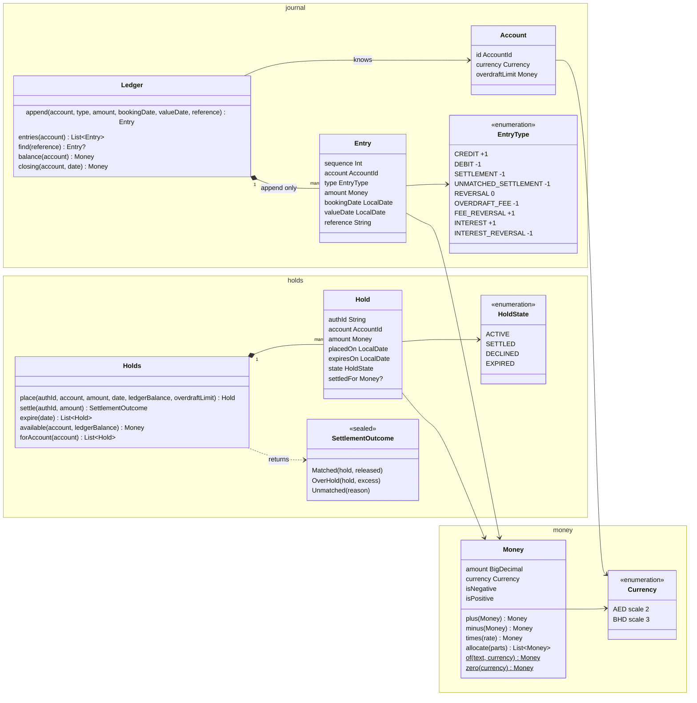
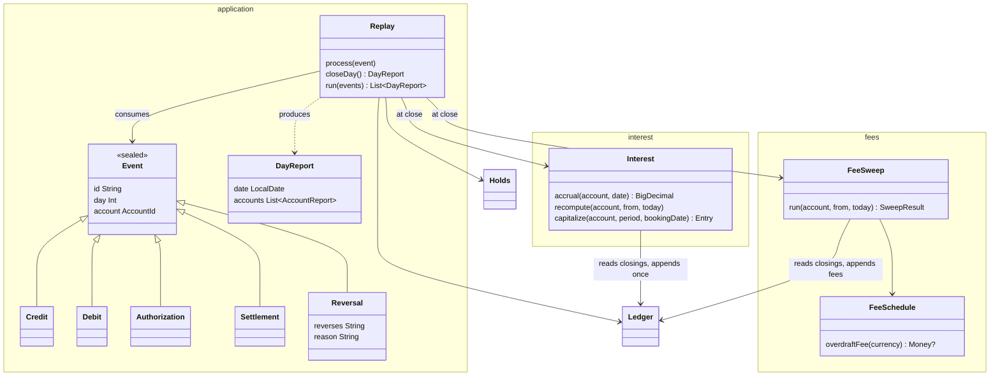

# Design

An in-memory account ledger core for two accounts over six processing days. No web layer, no persistence, no UI. A JUnit suite replays the event stream and prints, per day: closing ledger balance, fees, authorization states and errors.

## The question the design is built around

"What was that day's closing balance?" can have a different answer later than it had at the time, because an entry can arrive days after the day it belongs to. Everything below follows from taking that seriously:

- balances are derived, never stored
- rules re-run when the past changes
- corrections are new entries, never edits
- only authorizations are conditional: the ledger may say no to a hold. Everything that reports money already moved (credits, debits, settlements, reversals) is unconditional and always books; the fee rule handles the consequences

## Five concerns and one orchestrator

| Concern | Owns | Reads | Writes |
|---|---|---|---|
| Money | amounts at currency precision, rounding, splitting | — | — |
| Journal | append-only entries, closing balance by value date | — | entries |
| Holds | authorizations, available balance, settlement | journal balance | settlement entries |
| Fees | overdraft fee per overdrawn value day, and its reversal | journal closings | fee entries |
| Interest | daily accruals, one capitalization | journal closings | one interest entry |
| Replay | the processing clock, event dispatch, the per-day report | all of the above | — |

The first five are the domain: one rule from the brief each, one or two types, one test class. Replay is the application layer: sequencing and output, no business rule. There is no infrastructure, so there are no ports or adapters.

## Class diagrams

Domain: money, journal, holds.

Rules and orchestration: fees, interest, replay.

## Money

- `Money(amount: BigDecimal, currency)`: a value with its currency.
- The constructor refuses an amount whose scale differs from the currency's. A 2-decimal BHD figure cannot exist.
- Scales are hardcoded in `Currency` (AED 2, BHD 3) and verified against ISO 4217 by a test.
- `BigDecimal`, never floating point. Integer minor units would be the fallback without it.
- Rounding is HALF_EVEN, applied in one method. It changes no number in this stream.
- Splitting uses largest remainder: the parts differ by at most one minor unit and always sum to the original.
- Equality is by value; safe because the scale invariant means the same value can only ever have one representation.
- On the wire an amount is a decimal string plus a currency code. `Money.of` is that boundary.

## Journal

- An append-only list of entries, one sequence number each, in arrival order.
- An account: id, currency, overdraft limit (0 for both accounts here).
- An entry: account, type, signed amount, booking date, value date (both calendar dates), reference.
- Types: CREDIT, DEBIT, SETTLEMENT, UNMATCHED_SETTLEMENT, REVERSAL, OVERDRAFT_FEE, FEE_REVERSAL, INTEREST, INTEREST_REVERSAL.
- Signed amounts rather than two columns. The sign is guarded against the type at append.
- A reversal is just another line with the opposite sign. It references the entry it undoes and must carry a reason (duplicate, wrong amount, returned payment, won dispute, operations correction). A reversal without a reason cannot be constructed. The brief gives none for its reversal, so the scenario passes "not stated by the brief" explicitly and AMBIGUITIES records it.
- A reversal takes the original's value date, so the history reads as if the original never happened. A refund is different: new money, a CREDIT with its own value date.
- Only entries that came from events can be reversed by an event. Fees and interest are corrected by their own rules.
- An entry means money moved. Declines and rejections never become entries.
- `closing(account, day)`: sum of that account's entries with value date ≤ day. Recomputed on every call.
- Cost accepted: a scan per query. Bought: correctness under back-dating for free. A per-day index is the first thing to add at scale.

## Holds

- A hold is a promise, not a movement. It lives in the holds book beside the journal and never enters a balance.
- `available = ledger balance − active holds`.
- Authorizations are conditional: approve if `available − amount ≥ −overdraft limit`. The account's overdraft limit is a production knob; both accounts here have 0, so the rule reduces to "available stays at or above zero". Exactly zero approves.
- Debits and settlements are unconditional: they always book, whatever the balance.
- States: ACTIVE, SETTLED (keeps the settled amount), DECLINED (kept so the report can show it), EXPIRED.
- A hold expires at the close of the seventh day after it was placed, is released, and no longer counts against available. Scheme rules vary by merchant category (7 days for most, 30 for hotels and car rental); mapping expiry to merchant category codes is out of scope, 7 is used for all.
- A settlement is a command, not a request. It always books a debit. The auth id it quotes decides only how the entry is labelled:
  - ACTIVE hold, amount at or below it: SETTLEMENT. Hold → SETTLED, residual released.
  - ACTIVE hold, amount above it: SETTLEMENT, flagged with the excess. Hold → SETTLED.
  - No such auth id: UNMATCHED_SETTLEMENT, reason "never authorized".
  - Hold DECLINED: UNMATCHED_SETTLEMENT, reason "declined". Hold unchanged.
  - Hold already SETTLED: UNMATCHED_SETTLEMENT, reason "already settled". Hold unchanged.
  - Hold EXPIRED: UNMATCHED_SETTLEMENT, reason "expired". Hold unchanged.
- Why book the unmatched ones: the merchant has cleared and the issuer's obligation exists. The reason recorded on the entry is what a later dispute (chargeback, "I did not make this transaction") is raised from. Disputes themselves are out of scope; a won dispute would arrive as a REVERSAL of the settlement entry.
- Not modelled: void, incremental authorization, multiple clearings against one hold, account freeze.

## Fees

- The fee is checked when a day closes, not when a debit arrives. A debit that goes negative at 10am and is covered by 4pm costs nothing.
- Debits and settlements are never refused for lack of funds. Only authorizations are.
- When a day closes, the check starts at the earliest value date touched since the last close and runs oldest first through today. On a normal day that is today alone. A back-dated entry moves the start back to its value date.
- Oldest first matters: an earlier day's fee must be in place before the next day is judged.
- The check reads the day's closing balance before its own fee, so a fee never feeds its own test.
- Fees from earlier days do count toward later days.
- If the day is negative and has no fee yet: book one OVERDRAFT_FEE, booked today, valued that day.
- If the day is no longer negative and has a fee: book one FEE_REVERSAL of the same amount, booked today, valued that day. The fee stays in the journal; the net for that day is zero.
- One fee per account per day, ever. Running the check twice books nothing new.
- The fee is defined per currency. An overdraft in a currency without a defined fee is reported as an error and not charged.

## Interest

- Interest keeps its own state beside the journal: the unrounded accrual per account per day. It reads closing balances from the journal and writes to it only once per period, at capitalization. Until then the journal does not know interest exists.
- Accrual: earned, not yet paid. Capitalization: paid, one credit.
- Each day's accrual is the daily rate applied to that day's closing, zero unless positive. It is kept unrounded.
- Accruals are computed at the end of each day, after fees. A back-dated entry changes earlier days' balances, so their accruals are recomputed at that day's close too.
- Until they are paid, accruals are printed as provisional, rounded to the currency for display.
- Nothing is booked before the last day, so no adjustment is ever needed inside the window.
- When the last day of the period closes, after its fee check, the exact accruals are summed and rounded once; that is the amount paid, as one INTEREST entry.
- The daily figures are then rounded and the difference to the paid amount is handed out one minor unit at a time to the days that lost most in rounding, earliest first on ties. The rounded dailies therefore sum exactly to the payment. Same allocation rule as instalments.
- Why round once rather than pay the sum of rounded dailies: daily rounding leaks up to half a minor unit per day per account, growing with the period and with the number of accounts. Rounding once pays the true figure to the nearest minor unit.
- The credit is booked on the last day with value date the next day. Interest earned on a day never feeds that day's own balance; it is in the account from the day after.
- The report prints the exact unrounded interest beside the booked total.
- After capitalization, a back-dated entry that changes a paid period is corrected by reversing the INTEREST entry in full (INTEREST_REVERSAL) and booking a new INTEREST entry with the recomputed total, both carrying the same value date as the original interest entry. The type exists; the rule that books it is outside the window and is the subject of the one failing test.

## Replay

- Events are replayed in the given order. The clock never goes backwards.
- An event's "Day N" is the sender's label. The booking date is the processing day on which it was received.
- Dates in the ledger are calendar dates. The scenario translates "Day N" to a date from an anchor (Day 1 = the anchor); the report prints both the label and the date.
- An event labelled earlier than the clock is booked today with its stated value date and a warning.
- An event labelled later than the clock closes the intervening days first.
- Closing a day expires holds, runs fees, then interest, then prints the report.
- The report, per account: entries booked today, past days whose closing changed, closing and available balance, fees booked today, every hold and its state, provisional accruals, errors and warnings.

## Expected outcome

- ACC-001, final: 250.00, 250.00, 650.00, 285.00, 285.00, 285.00. Interest of 0.80 booked on Day 6, valued Day 7.
- ACC-001, as known at the end of Day 5: 250.00, −395.00, 5.00, −385.00, −410.00. Three fees booked that day valued Days 2, 4, 5; three reversals on Day 6.
- Auth-A approved Day 2, settled Day 4 for 185.00 of 200.00. Auth-B declined Day 5.
- Interest: exact 0.802, paid 0.80. Dailies 0.10, 0.10, 0.26, 0.12, 0.11, 0.11.
- ACC-002: 3.334 / 3.333 / 3.333 valued Day 5, booked Day 6. Interest 0.004 + 0.004 = 0.008, booked Day 6, valued Day 7. Closes Day 6 at 10.000.
